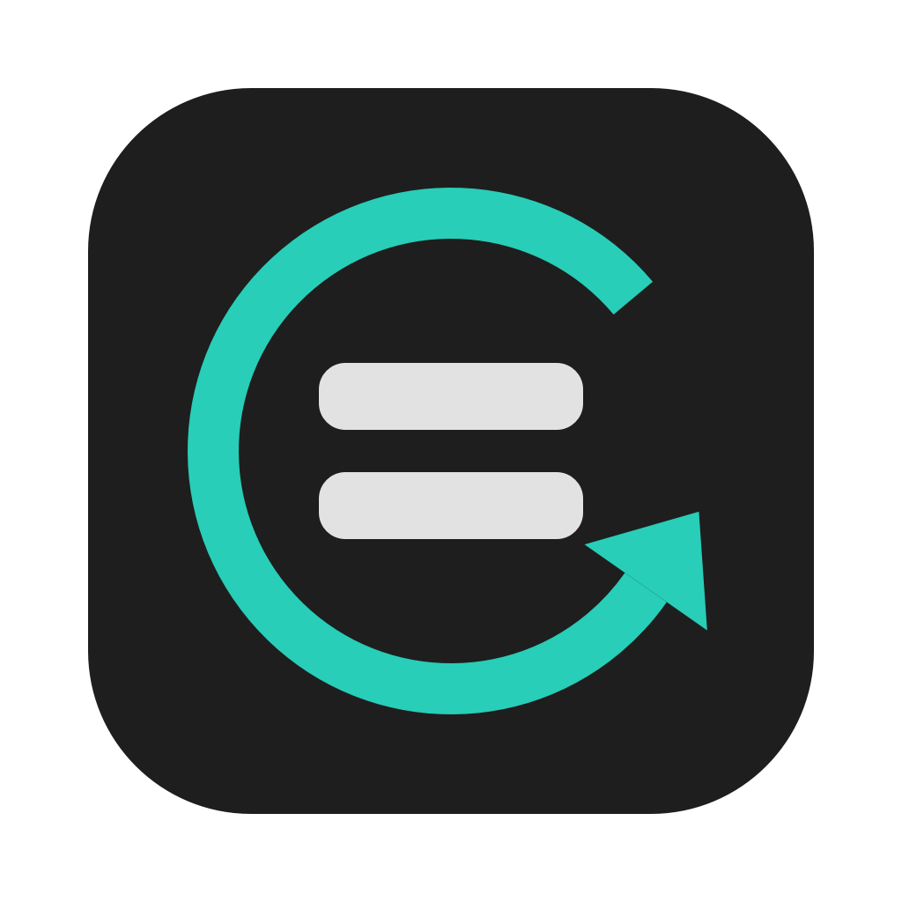

<p align="center"></p>

# mBACKUP

[](https://openmacapps.com/apps/mbackup/) [](https://github.com/starbudweiser/mBACKUP/releases/latest) [](LICENSE)

Scheduled mirror copies of your folders, in the menu bar. A personal, simplified alternative to Get Backup Pro.

🇬🇧 English · 🇫🇷 [Français](#français)

## About

mBACKUP is made by Starbudweiser & Claude Code (Anthropic). MIT License, © 2026 Starbudweiser. Provided as is, without warranty: check your copies before relying on them. Inspired by Get Backup Pro, not affiliated with BeLight Software. See "About mBACKUP" in the app menu.

## Features

- Mirror synchronization (rsync 3.x) from a source folder to a destination, with the same options as Get Backup Pro.
- Per-task schedule (days, time), catch-up of a missed run, automatic mounting of external disks and SMB shares.
- Optional versioned copies (replaced or deleted files go to a dated folder next to the destination, N kept).
- Dry run (simulation), exclusion patterns, optional administrator rights per task (password stored in the Keychain).
- Menu bar app, opens at login. Interface follows the Socle design system.
- Automatic updates from GitHub releases (daily check, Developer ID signature verified), with an "install automatically" option and a manual check button in the settings.

## Install

**[Download the latest notarized release](https://github.com/starbudweiser/mBACKUP/releases/latest)** (zip), unzip it and move **mBACKUP.app** to your Applications folder. Requires **macOS 15 Sequoia** or later on Apple Silicon.

If protected folders fail (iCloud Drive, Library), grant mBACKUP Full Disk Access in System Settings.

## Build

```bash
./build_app.sh     # builds, signs and installs ~/Applications/Applications Personnelles/mBACKUP.app
./tests/run_tests.sh
```

The build embeds the rsync 3.2.3 binary kept in `Resources/rsync`, and falls back to the system rsync if it is missing. rsync is free software under the GNU GPL v3 (© Andrew Tridgell, Wayne Davison and contributors); its source code is available at https://rsync.samba.org and https://github.com/RsyncProject/rsync. It is shipped unmodified.

## Languages

English, French, Spanish and Italian. The app follows your Mac's preferred language automatically (English if it is none of these four).

## Support

Bug reports and suggestions: [GitHub Issues](https://github.com/starbudweiser/mBACKUP/issues).

## License

Released under the **MIT License**, © 2026 Starbudweiser. See [LICENSE](LICENSE). The bundled rsync binary is under the GNU GPL v3 (see Build).

---

## Français

Copies miroir planifiées de vos dossiers, depuis la barre de menus. Une alternative personnelle et simplifiée à Get Backup Pro.

- Synchronisation miroir (rsync 3.x) d'un dossier source vers une destination, avec les mêmes options que Get Backup Pro.
- Planification par tâche (jours, heure), rattrapage d'une exécution manquée, montage automatique des disques externes et des partages SMB.
- Copies versionnées facultatives (les fichiers remplacés ou supprimés vont dans un dossier daté à côté de la destination, N conservés).
- Simulation, motifs d'exclusion, droits administrateur facultatifs par tâche (mot de passe rangé dans le Trousseau).
- Appli de barre de menus, ouverte à la connexion ; mise à jour automatique depuis les releases GitHub.

**Installation** : téléchargez la [dernière version notarisée](https://github.com/starbudweiser/mBACKUP/releases/latest), décompressez-la et placez **mBACKUP.app** dans Applications (macOS 15 Sequoia ou plus récent, Apple Silicon). Si des dossiers protégés échouent (iCloud Drive, Bibliothèque), accordez à mBACKUP l'accès complet au disque dans Réglages Système.

Interface en français, anglais, espagnol et italien, choisie d'après la langue du Mac. Licence MIT. Inspirée de Get Backup Pro, sans lien avec BeLight Software. Vérifiez vos copies avant de vous y fier.
